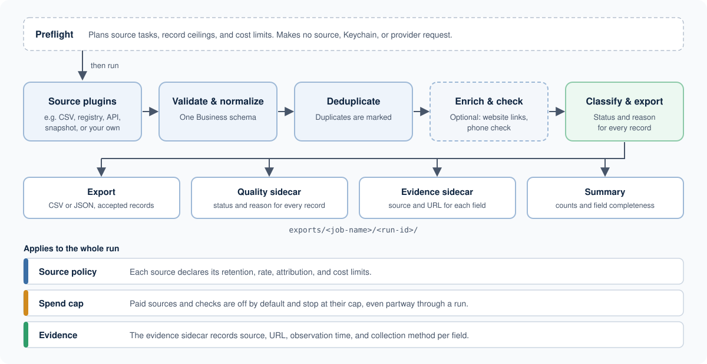

# Biz Intel

Biz Intel ingests business records from one or more approved sources,
normalizes them into one `Business` schema, removes duplicates, optionally
enriches or checks them, and exports the result with the evidence behind each
field.

It is a framework for producing scoped, auditable client datasets—not a tool
for bypassing a website’s rules or building an unaccountable contact database.

## Concepts

**Source.** A plugin that reads records from one place: a CSV, registry, API,
or local snapshot. Each source converts its input into `Business` records.

**Source policy.** Every source declares a `SourcePolicy` in code. It records
whether client delivery/export is allowed, plus retention, rate, attribution,
fixture, and cost constraints. Technical access never grants delivery rights.

**Job.** A YAML file describing one run: what to search for, which sources to
use, what processing to apply, and which fields to write out.

**Run.** One execution of a job. Every run has an ID and its own output folder.

**Evidence.** For an exported field: where the value came from, its URL, when
it was observed, and how it was collected.

## How it works



```text
Source plugin(s)
        ↓
Validate → normalize → deduplicate
        ↓
Optional first-party enrichment / phone check
        ↓
Classify quality → export → evidence and run summary
```

Whatever the input, every record follows the same cleanup and export steps.

## Quick start

Requirements: Python 3.12+ and [uv](https://github.com/astral-sh/uv).

```bash
uv sync
cp .env.example .env
```

Provider credentials are read from macOS Keychain first. Use the generic-
password service `biz-intel` and the environment-variable name as the account
label, such as `APIFY_API_KEY` or `GOOGLE_PLACES_API_KEY`. The ignored `.env`
file is a local fallback using the same names; it is never the preferred store.

The default path is a CSV of your own: a seed list, a spreadsheet, or a prior
export you want to clean again. Save this as `jobs/my_csv_job.yaml` and point
`path` at your input file.

```yaml
version: 1
name: my-business-cleanup
search:
  query: local businesses
sources:
  - csv
processing:
  deduplicate: true
  enrich: false # enable first-party website enrichment deliberately
delivery:
  profile: standard
output:
  format: csv
  fields:
    - name
    - address
    - city
    - state
    - phone
    - website
    - linkedin
    - instagram
source_options:
  csv:
    path: data/raw/businesses.csv
```

Check the plan, then run it:

```bash
biz-intel preflight jobs/my_csv_job.yaml
biz-intel run jobs/my_csv_job.yaml
```

### Progressive research skeleton

An existing search job can also start a persistent research session. The
session keeps the current businesses, evidence-backed claims, and each later
refinement instead of restarting the search:

```bash
biz-intel research jobs/oct_dentists_san_jose_metro.yaml \
  "Dentists in San Jose"
```

The command prints the session path. One supported plain-language refinement
checks exact NPIs against California DHCS's public Medi-Cal Dental FFS
directory:

```bash
biz-intel refine runs/research/<run-id>.json \
  "Which dentists accept Medi-Cal?"
```

The resulting claim establishes official FFS enrollment only. It does not
claim that a provider is currently accepting new patients, and records without
an exact NPI match remain unknown.

A second refinement looks for explicit ownership language on the business's
own website:

```bash
biz-intel refine runs/research/<run-id>.json \
  "Which practices look family-owned or independent?"
```

It labels only explicit first-party signals as `likely_independent` or
`likely_corporate`. It does not infer ownership from the name, number of
locations, or missing language; those records remain unclear and stay in the
session.

Publicly posted email addresses can be gathered from the same first-party
pages without selecting an email-verification provider:

```bash
biz-intel refine runs/research/<run-id>.json \
  "Find their public email addresses"
```

The evidence page is retained and the email remains `not_checked`; discovery
does not imply deliverability.

LinkedIn and other social profiles linked by the business itself use the same
bounded crawl:

```bash
biz-intel refine runs/research/<run-id>.json \
  "Find LinkedIn and other socials"
```

LinkedIn, Instagram, Facebook, and X/Twitter links retain the first-party page
where each profile was found.

The session remains the evidence-rich research workspace. Export a clean,
flat client-facing view when the research is ready:

```bash
biz-intel research-export runs/research/<run-id>.json exports/dentists.csv
```

CSV and JSON exports include core business/contact fields, social profiles,
Medi-Cal enrollment, ownership assessment, the discovery sources, and
a combined evidence-links column. Unknown and unclear values remain explicit.
When exact duplicate candidates come from more than one source, the canonical
business row retains each contributing source name.

An earlier CSV or JSON result can become a session without rerunning candidate
search:

```bash
biz-intel research-import exports/dentists.csv \
  "Dentists in San Jose" \
  --session runs/research/dentists.json
```

Known NPPES registry URLs are converted back into exact NPI identifiers, so a
saved NPPES export can continue into later evidence refinements.

`preflight` makes no source, Keychain, or provider request. It reports planned
tasks, record ceilings, and known cost limits. Resume an interrupted run from
its sanitized checkpoint:

```bash
biz-intel resume jobs/my_csv_job.yaml runs/<run-id>.checkpoint.json
```

## Job recipes

Start from one of these and keep the job narrowly scoped to the client’s
request.

### CSV cleanup and first-party enrichment

The default recipe preserves the original record, cleans fields, and
deduplicates. When a client needs business-published contacts or social links,
enable the bounded first-party enrichment step:

```yaml
processing:
  enrich: true
```

It only visits the business website after deduplication and stays within
same-origin and site-policy limits.

### NPPES provider candidates

`nppes` reads the official US provider registry for provider identity, practice
location, and practice phone. It is bounded by the limits you set. The registry
does not establish licensing status, email ownership, social identity, or
contact consent.

```yaml
search:
  query: dentist
  cities:
    - San Jose, CA
sources:
  - nppes
limits:
  total_records: 100
  per_source_records: 100
```

### Overture snapshot

`overture` reads a local GeoParquet snapshot plus a companion manifest. The
manifest pins the release, retrieval time, geographic/taxonomy scope,
attribution/license, row count, and content hash. The job reads the frozen file
and never queries Overture live.

```yaml
sources:
  - overture
source_options:
  overture:
    path: data/snapshots/places.parquet
    manifest_path: data/snapshots/places.manifest.json
```

Overture is implemented as candidate acquisition but remains blocked from
client delivery until the exact source rights and client use are reviewed.

### Optional phone check — Twilio Lookup Basic

Twilio Lookup Basic runs after deduplication and reports whether a number is
technically valid. It does not establish ownership, business identity, consent,
or permission to contact someone.

Store a restricted Lookup API key and secret in macOS Keychain:

| Keychain service | Keychain account |
| --- | --- |
| `biz-intel` | `TWILIO_API_KEY` |
| `biz-intel` | `TWILIO_API_SECRET` |

Then add this to a job with an approved budget and client reference:

```yaml
verification:
  phone:
    provider: twilio_lookup_basic
    credential_service: biz-intel
    api_key_account: TWILIO_API_KEY
    api_secret_account: TWILIO_API_SECRET
```

An ignored local `.env` may hold the same variable names as a development
fallback. Credentials never go in job YAML, fixtures, manifests, sidecars, or
Git.

## Output

Each run writes client-facing files to `exports/<job-name>/<run-id>/`:

- **Main CSV or JSON export:** accepted records with requested fields.
- **Quality sidecar:** every record’s status and why it was held for review,
  excluded, or marked duplicate.
- **Evidence sidecar:** field source, evidence URL, observation time, and
  collection method—without raw provider payloads.
- **Summary:** acquired, deduplicated, accepted, and review counts, plus field
  completeness and safe pipeline metrics.

Run manifests, checkpoints, and accepted-record history live under `runs/`.
The default `standard` profile accepts a record only if it has a business name,
meaningful location, phone or website, evidence URL, and observation time.
Missing data is left blank.

## Sources

| Source | Delivery status | Intended use |
| --- | --- | --- |
| `csv` | allowed | Client input, seed lists, and prior exports. |
| `nppes` | approved V1 path | Provider identity, practice location, and practice phone. |
| `wa-li` | registry research | Washington contractor-registration evidence. |
| `ca-dental-board` | manual evidence import | California dental-license review; no automated Board lookup. |
| `overture` | blocked | Reviewed local candidate snapshot only. |
| `google`, `yelp`, `yellowpages` | blocked | Experimental connectors pending source-specific review. |
| `*-apify`, including `linkedin-apify` | blocked | Actor-backed observations; hosting does not grant delivery rights. |

Paid acquisition or verification needs more than a spend cap: the source must
be approved for the client’s intended use, and the job must set a finite cap,
budget, and approval reference. Default delivery is zero spend.

## Safeguards

- Email checks are structural only. Deliverability verification awaits an
  approved provider, terms, and budget.
- Tests use sanitized fixtures; live provider calls are not ordinary tests.
- Experimental sources retain no contact-detail cache entries. Approved sources
  follow the retention declared in their policy.

## Development

```bash
uv run python -m unittest discover -s tests -v
```

Git history holds the detailed implementation record.
